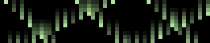

# galactic-clock

Pimoroni Galactic Unicorn (53x11 LED matrix) on a Raspberry Pi Pico W running
MicroPython. A weather clock that rotates four screens on the matrix:

- **clock** — local time, RTC synced via NTP (EU DST computed in pure integer
  math in `src/tz.py` — MicroPython has no tzdata), blinking colon; shown only
  when the RTC is trustworthy (NTP-synced, or already reading >= 2026 after a
  soft reset) — otherwise the slot shows `no ntp`
- **weather** — animated 10x11 icon + current temperature from open-meteo (no
  API key); icons are hand-drawn pixel art per WMO code with day/night variants
  (twinkling sun/moon, drifting fog bands, falling rain/snow, flashing storm bolt)
- **hi/lo** — today's high/low with up/down arrows
- **CO2** — ppm from an optional SCD41 sensor on the STEMMA QT connector,
  color-coded green/amber/red by indoor air quality

Buttons: **A** toggles the **matrix rain** mode — one anti-aliased drop per
column (subpixel motion, gradual brightness between rows) with a fading trail.
Five speed/brightness tiers (very dim crawl → full-brightness sprint) are
hashed across the columns, gaps between passes span 4–11 rows, and ~1 pass in
10 rests entirely, so the rain's density and tempo visibly breathe; each drop's
head cycles through a few subtle green variations as it falls and settles on
its hue
for the second half of the pass, and every pass mixes its hue and trail length
from a deterministic LCG (no randomness — sim and board render identically).
One press plays it full-screen for two minutes (a second press stops it early),
then the regular rotation resumes. With a trusted RTC the clock shows through
the rain (`sim/sim.py --screen rainclock`): the clock phases in over ~0.5 s
on entry and back out on exit, and at full strength the field dims to 35 %
alpha inside the clock's text box while bright white digits draw on top, so
the rain visibly
pours across the time; without a trusted RTC the rain runs alone (same rule as
the rotation's clock-hiding). The rain keeps a persistent frame tick
across runs, so it always continues where it left off.


The regular rotation (clock → animated weather → hi/lo → CO2), rendered by the
host sim from the real `main.py` — regenerate with
`python3 sim/run_main.py --seconds 24 --delay 0.12 --gif docs/demo-rotation.gif`
(needs Pillow; these GIFs are tracked, all other recordings stay uncommitted).



The matrix rain mode, `python3 sim/sim.py play --screen matrix --frames 60
--delay 0.03 --gif docs/demo-matrix.gif` (30 ms preview grid; the board paces
the same frames at 1/30 s ≈ 33 ms); `sim/check_demo_gif.py` (CI) enforces
that both GIFs match the code.

## Hardware & host setup

- Pimoroni Galactic Unicorn (Pico W); optional SCD41 CO2 sensor (STEMMA QT, SDA=4/SCL=5)
- Windows 11 host + WSL2 (Ubuntu-24.04) — GitHub: `abalawender/galactic-clock`
- Board on host USB bus 2-2; usbipd: `usbipd.exe`; `mpremote` (apt install micropython-mpremote)
- Pillow — only needed for `--gif` output in the sim (everything else is stdlib)
- Firmware: MicroPython v1.29.0 board build `pico_w_galactic-v1.29.0-micropython.uf2`
  from https://github.com/pimoroni/unicorn/releases/tag/v1.29.0
  (local copy in `firmware/`, gitignored — flashing notes in `docs/flashing.md`)

## Connect

```
# once, as admin on Windows:
usbipd bind --busid 2-2
# from WSL:
usbipd.exe attach --wsl --busid 2-2   # -> /dev/ttyACM0
mpremote exec "import os; print(os.uname().version)"
```

## Board configuration (`secrets.py`)

The board reads `/secrets.py` at boot. It is gitignored and lives only on the
board flash — never commit it, never print it, never copy it back off the
board. To create it, copy the committed template `secrets.example.py` — each
variable is documented inline there (WiFi, location, `TZ`, optional
`SCD41_ALTITUDE_M`) — and fill in real values:

```
cp secrets.example.py secrets.py     # fill in real values
mpremote cp secrets.py :secrets.py   # host -> board only
rm secrets.py                        # board holds the only copy
```

## Board API

```python
from galactic import GalacticUnicorn
from picographics import PicoGraphics, DISPLAY_GALACTIC_UNICORN
gu = GalacticUnicorn()                       # 53x11
d = PicoGraphics(display=DISPLAY_GALACTIC_UNICORN)
d.set_pen(d.create_pen(255, 60, 0))
d.pixel(26, 5)
gu.update(d)
```

## Simulate on the host

See exactly what the 53x11 matrix will show — without touching the board.
`sim/sim.py` runs the same `src/render.py` as the board, with a faithful
re-implementation of the PicoGraphics bitmap6 font (`sim/font6_data.py`), so
layouts match the device pixel-for-pixel. The sim never reads `secrets.py`;
weather values are CLI args (`--code/--temp/--hi/--lo/--night`).

```
python3 sim/sim.py print  --screen weather --code 61 --temp 21 --frames 8
                              # plain ASCII frames on stdout (for agent analysis)
python3 sim/sim.py play   --screen weather --code 61 --temp 21   # animate in terminal
python3 sim/sim.py play   --screen weather --code 0 --night      # moon + stars
python3 sim/sim.py play   --screen icons --frames 8              # contact sheet: all icons
python3 sim/sim.py play   --screen hilo --hi 25 --lo 18
python3 sim/sim.py play   --screen matrix --frames 60         # code rain
```

See it in motion — render any screen, or the whole display loop of the real
`main.py` (fully mocked: WiFi/NTP/open-meteo/SCD41), to an animated GIF
(needs Pillow; GIFs are gitignored and generated on demand for PRs — the only
tracked one is the README demo above):

```
python3 sim/run_main.py --seconds 24 --gif /tmp/rotation.gif   # clock -> weather -> hi/lo -> CO2
python3 sim/sim.py play --screen matrix --frames 60 --gif /tmp/matrix.gif
python3 sim/sim.py play --screen icons --frames 8 --gif /tmp/icons.gif
python3 sim/sim.py play --screen weather --code 61 --temp 21 --frames 12 --gif /tmp/rain.gif
```

HITL review on the physical board (see all icons before approving a PR):
`python3 skills/unicorn/display.py --icons` cycles every weather icon on the
matrix, 3 s each, WMO code labelled (`n` = night); then `--stop` and
`mpremote reset` return to the clock.

The weather icon (10x11, left of the temperature) is animated per WMO code:
twinkling sun/moon, partly-cloudy sun+moon peeking behind a drifting cloud,
fog bands, falling rain streaks (drizzle/snow fall slower, showers pulse,
heavy variants denser), and a flashing bolt for storms. The icons are
hand-drawn 10x11 pixel art, tuned frame by frame in the sim.

Recordings are generated on demand and never committed (gitignored). For PR
reviews, before/after GIFs of every screen (base ref vs PR head) are rendered
automatically:

```
python3 sim/before_after.py --ref origin/micropython --out /tmp/pr
                              # writes /tmp/pr_<screen>_{before,after,compare}.gif per screen
                              # (weather/icons/clock/hilo/co2) plus pr_rotation_* — a full mocked
                              # run of the real main.py (sim/run_main.py), robust to screen changes.
                              # "icons" is a contact sheet of every animated weather icon
                              # (WMO code x day/night) in one GIF. --ref takes the PR base SHA
                              # (CI passes github.event.pull_request.base.sha); locally use
                              # origin/micropython. Screens pixel-identical to the base
                              # produce no GIFs at all, so the CI upload/PR comment skips
                              # them — the review only shows what changed. Attach the GIFs
                              # to the PR; CI does this automatically.
```

## Development

- Tests (host-only, no board): `python3 -m unittest discover -s tests -v` —
  rendered-bitmap property checks, golden ASCII dumps, EU DST rules, and a
  fully mocked run of the real `main.py`
- Preview every display change in `sim/` before deploying (above)
- Deploy: `scripts/deploy.sh` — attaches the board first if `/dev/ttyACM0` is
  missing (see Connect above), uploads `main.py` + `src/render.py` + `src/tz.py`,
  then resets the board
- PRs to `micropython` that touch `main.py`/`src/`/`sim/`/`tests/` run the tests
  and post before/after GIFs inline on the PR — see `.github/workflows/pr-sim.yml`
- `micropython-check` (`.github/workflows/micropython-check.yml`) runs on PRs to
  `micropython` and on pushes to it: tests + a check that the tracked demo GIF
  above matches the code (`sim/check_demo_gif.py`). It is a required status
  check under the `micropython` ruleset (rebase-only merges, one approving
  review, resolved threads). If you change rendering, regenerate
  `docs/demo-rotation.gif` in the same PR (command above the GIF)

## Layout

- `AGENTS.md` — ramp-up essentials: golden rules, workflow, layout
- `main.py` — board entry point: WiFi/NTP/open-meteo/SCD41 + screen loop (thin)
- `src/render.py` — all drawing; pure functions, no board imports (also runs in the sim)
- `src/tz.py` — EU DST offset in pure integer math (MicroPython has no tzdata)
- `sim/` — host simulator: `sim.py` (play/print/GIF), `font6_data.py` (real
  bitmap6 font metrics), `run_main.py` (mocked full run of `main.py`),
  `before_after.py` (PR review GIFs), `gif.py` (Pillow writer)
- `tests/` — unittest suite (bitmaps, golden ASCII, tz rules, mocked main loop)
- `scripts/` — attach.sh, deploy.sh (uploads `main.py` + `render.py` + `tz.py`, resets board)
- `skills/` — agent skills: board access via mpremote (attach/recovery, REPL
  rules, flash files) in `mpremote`; the Galactic Unicorn board itself (LED
  matrix display snippets, frozen `galactic` synth API) in `unicorn`
- `docs/` — flashing notes, hardware resource inventory (`hardware.md`) + the tracked README demo GIF; `firmware/` — local uf2 copy (gitignored)

## License & contributing

MIT — see [LICENSE](LICENSE). Contributions (mostly AI agents) follow
[AGENTS.md](AGENTS.md): branch off `micropython` with small atomic commits,
and CI will run the tests and post before/after GIF previews inline on the PR.
